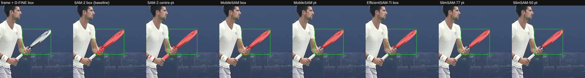
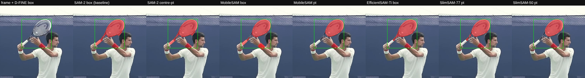
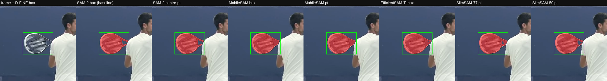

# Spike: lighter promptable segmenters for phones (UNTRACKED, evaluation only — nothing in the app changed)

Scope: replace SAM-2 (SAM2.1-hiera-tiny q4f16) on **phones only**, desktop and D-FINE unchanged. No model is license-cleared (see §Licensing).

## Method (what was actually run)
- Chromium (Playwright preinstalled), page + **module worker per model, terminated between runs**, fresh browser per model, `window.__stroPhoneBudget=true`, ORT `enableCpuMemArena:false, enableMemPattern:false` (= `PHONE_ORT_SESSION_OPTIONS`), wasm EP, **1 thread** (app sends COEP `unsafe-none` => not cross-origin-isolated). transformers.js 4.2.0 / onnxruntime-web 1.26.0-dev.20260416 (same as package-lock). Frames: `Demodjokovic.mp4` 15 s -> VP9 WebM (1280 px wide) -> `<video>` seek -> canvas.
- Prompts: D-FINE-n (app weights, q4f16, `graphOptimizationLevel:'basic'`, score >= 0.10) best "tennis racket" box per frame. **No wrist gate** (no keypoints in the harness). 8 frames (t = 1, 2, 3, 4, 9, 10, 13.5, 14 s), per frame: encode, decode with BOX and with box-CENTRE POINT, embedding dropped.
- Candidate masks picked with the app's rule (area 0.002–12 %, >= 50 % inside box, best IoU-score). IoU = binary (logit > 0) mask vs **SAM-2 box mask** (baseline, not ground truth).
- Memory = sum of `--type=renderer` RSS from `ps`, settled 1.5 s. Worker shares the renderer. "idle" = page loaded, no frames; the 8 decoded frames add ~80 MB to every row equally. n = 1 run per model. **Desktop RSS, relative comparison only — not iPhone memory.**
- Harness: `docs/racket_model_spike/` (`worker.mjs`, `bench.cjs`, `harness.html`, `detections.json`). The per-model raw result JSONs (`res_*.json`, 1.2–2.5 MB each, incl. the discarded bad-preprocessing MobileSAM run) are NOT committed (1 MB limit); they hold the per-frame bit-packed masks and can be regenerated with `bench.cjs`.
- Integration bug caught and fixed during the spike: Acly MobileSAM encoder needs the caller to resize the long edge to 1024 (native-size input gave offset blobs, mean IoU 0.38). The first run was discarded (not committed); all MobileSAM numbers below are the corrected run. Treat the other candidates' preprocessing as "works, plausibly not optimal".

## Results
| model (weights used) | files, size | weights license (declared) | idle / after load / after 1 enc / after 5 enc (MB renderer) [peak] | mean IoU vs SAM-2 box | encode (1 thread desktop) | notes |
|---|---|---|---|---|---|---|
| **SAM-2.1 hiera-tiny q4f16** (baseline) | vision_encoder 0.33+28.5 MB, decoder 0.24+4.6 MB = **33.7 MB** | apache-2.0 (facebook/sam2.1-hiera-tiny); ONNX repo onnx-community has no license tag | 129 / 409 / **1099** / 1135 [1197] | 1.00 (ref); centre-point 0.916 | 16.7 s | decode ~0.4 s |
| **MobileSAM** (Acly/MobileSAM fp32) | encoder 28.2 MB + decoder_multi 16.5 MB = **44.7 MB** | repo tag **MIT**; upstream code Apache-2.0 (LICENSE read); weights at dhkim2810/MobileSAM tagged MIT — **mismatch to resolve** | 129 / 435 / **641** / 629 [807] | **box 0.904**, point 0.875 | 4.9 s | box prompt natively supported; 0 vetoed frames |
| **EfficientSAM-Ti** (yunyangx/EfficientSAM fp32) | encoder 24.8 MB + decoder 16.6 MB = **41.4 MB** | apache-2.0 (authors' repo) | 129 / 438 / **853** / 833 [1062] | box 0.889, point 0.866 | 10.5 s | box natively supported |
| **SlimSAM-77** (Xenova q8) | enc 8.9 MB + dec 4.9 MB = **13.8 MB** (fp16 12.2+8.6, fp32 23.3+16.6 exist, not tested) | apache-2.0 (Xenova, base nielsr/slimsam-77-uniform; Zigeng/SlimSAM-uniform-77 apache-2.0) | 128 / 400 / **2014** / 2040 [2182] | point 0.887; **box prompt unsupported** (decoder is points-only; corner-point trick: 4/8 frames no mask, mean 0.30) | 8.9 s | **uses MORE memory than SAM-2** |
| **SlimSAM-50** (Xenova q8) | enc 30.1 MB + dec 4.9 MB = **35.0 MB** | apache-2.0 | 129 / 457 / **2059** / 2161 [2231] | point 0.881; box as above | 14.8 s | same memory problem |
| EdgeSAM | — | S-Lab 1.0 non-commercial | — | — | — | **excluded** |

Memory deltas vs SAM-2 after 1 encode: MobileSAM **-42 %** (peak -33 %), EfficientSAM-Ti -22 % (peak -11 %), SlimSAM +83 % / +87 %. Growth over further frames is small for all (embedding dropped per frame, no arena).
Note: "after load" here (409 MB) is lower than the ~1.1 GB the existing memory doc quotes for SAM-2 at load; in this harness the ~1.1 GB appears after the first encode. Likely ORT allocates lazily; not investigated.
SlimSAM's high memory is unexplained (hypothesis, unverified: SAM-ViT global attention at 64x64 tokens keeps large activations even when pruned/quantized; MobileSAM's TinyViT uses windowed attention).

Quality (side by side, crops around the D-FINE box; red = mask, green = prompt box): `racket_model_spike/frame_*s.png`
columns: frame | SAM-2 box | SAM-2 centre-point | MobileSAM box | MobileSAM pt | EfficientSAM box | SlimSAM-77 pt | SlimSAM-50 pt.
 

Per-frame IoU vs SAM-2 box (frames 1,2,3,4,9,10,13.5,14): MobileSAM box .837 .824 .951 .827 .951 .940 .936 .966; EfficientSAM box .752 .777 .939 .856 .942 .947 .940 .955; SlimSAM-77 pt .713 .810 .949 .858 .945 .925 .944 .954; SlimSAM-50 pt .726 .802 .948 .793 .934 .937 .963 .940. Lowest IoU is on the thin, motion-blurred racket at t=1–2 s (handle/frame differences) for every model. All models, SAM-2 included, sometimes merge the red wristband into the racket mask (frame 4 s) — pre-existing behaviour of the box prompt, not a candidate regression.
Limits: 8 frames, one clip, one player; IoU against SAM-2 not against hand-labelled truth; soft-alpha edges not compared.

## Licensing (provenance; **not cleared — for the architect's lawyer**)
- All candidates are distilled/pruned from SAM and trained on Meta **SA-1B** images (SlimSAM README: "We use the original SA-1B dataset"; MobileSAM README: 100k images = 1 % of SA-1B; EfficientSAM per its paper pretrains with SA-1B — paper not re-read here). SA-1B has its own research-oriented terms; whether apache/MIT tags on derived weights hold for commercial use is a legal question. SAM-2's own training data (SA-V, others) was not checked in this spike, so SAM-2 is not shown to be cleaner.
- MobileSAM: code Apache-2.0 (LICENSE read); the ONNX we used is a **third-party export** (Acly) tagged MIT, weights from dhkim2810 tagged MIT; the Apache/MIT inconsistency needs a decision.
- SlimSAM: Apache-2.0 on code (LICENSE read), Zigeng and Xenova model cards. EfficientSAM: Apache-2.0 (LICENSE read; authors' HF repo tag).

## Integration effort (estimate only, nothing implemented) — MobileSAM, phones only
1. New `lib/stroMotionDraft/mobileSamRacket.ts` (ORT-web direct, not transformers.js; ~250 lines): same exports as `samRacket.ts` used by the worker (`encodeFrameForRacket`, `decodeRacketMaskFromBox`, `decodeRacketMask`, `dropRacketEncoding`, `getLastSamError`), reusing the area/in-box gate and logit->alpha ramp. Prompt maths is simpler than SAM-2 (long-edge scale, labels 2/3 for box, -1 pad point).
2. `racketWorker.ts`: choose module by `phone` flag at `init` (~15 lines); message API unchanged, so `racketWorkerClient.ts`, `racketEditorSam.ts` and `autoRacketPass.ts` need no change.
3. Object tool (`components/stroMotion/FrameMaskEditor.tsx`, via `decodeViaWorker`): points accumulate with negative points and `forceCandidate`; the MobileSAM decoder supports multi-point + labels and returns 4 masks, but this is **untested in the spike** — candidate indexing (multi-mask vs "single" output) and the candidate chooser UI need a check. Embedding is ~16 MB (256x64x64 fp32), same order as today.
4. Assets: 45 MB of ONNX under `public/models/mobilesam/` (+11 MB vs SAM-2), `sw.js`/offline cache entry, ORT wasm already shipped.
5. Tests: no UI tests exist; unit-test the prompt scaling/candidate gate; manual repro on real iPhone. Estimate **~2–3 dev days + real-device validation**, risk concentrated in Object-tool behaviour and licensing, not plumbing.

## Recommendation: **needs more work** (do not switch yet)
- MobileSAM is the only candidate that cuts the first-encode renderer footprint materially (-42 %) at near-SAM-2 mask quality (IoU 0.90, 3.4x faster encode). EfficientSAM-Ti is a weaker second choice. **SlimSAM: no** (more memory than SAM-2 here, and a points-only decoder).
- But: desktop RSS only, one clip, 8 frames, 1-thread wasm; the ~640 MB floor may still be too much for an iPhone kill threshold we do not know; D-FINE (~250 MB) and the page still add on top.

## Open questions for the architect
1. Licensing: is an SA-1B-derived MobileSAM acceptable for commercial use (and is SAM-2's own provenance acceptable)? Which license governs the Acly/dhkim2810 weights (MIT tag vs Apache-2.0 upstream)? Re-export from the official MobileSAM checkpoint ourselves?
2. Is a ~33 % lower peak enough, or does the architect want an on-device test first (real iPhone, same 8 frames, Safari memory readout) before any implementation?
3. Accept phones using a different mask engine than desktop (masks differ slightly: IoU 0.90 vs SAM-2, lowest on thin blurred rackets)?
4. Is it worth also measuring Auto-detect end-to-end (D-FINE worker + segmenter worker recycling) and the Object tool with the candidate, and fp16/quantized MobileSAM (45 MB fp32 only here)?
